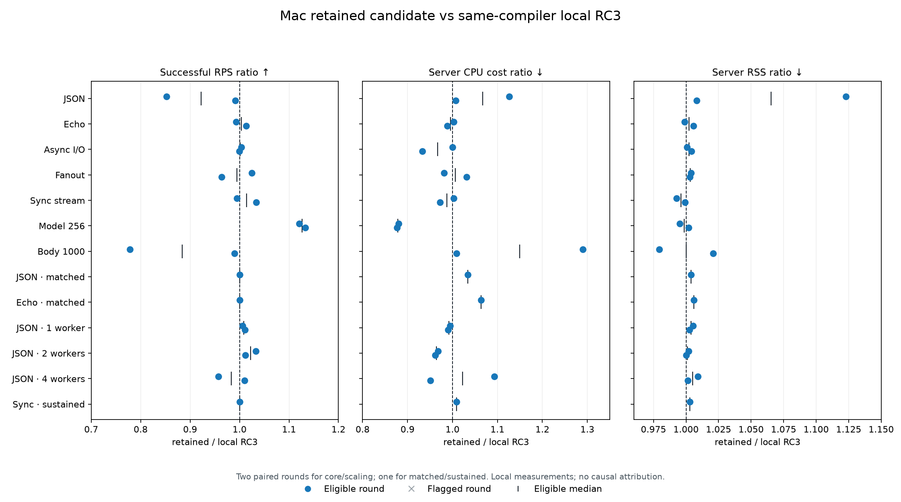

# RC3 runtime improvements and local benchmarks

The retained patch fixes adaptive sync-pool growth after the final submission
and speeds up ordered Pydantic response dictionaries. Linux worker scaling is
demonstrated with a separate, adequately provisioned Linux client. Large upload
throughput and the macOS two-to-four-worker plateau remain unresolved.

## Retained changes and measured results

| Area | Change or measurement | Result |
| --- | --- | --- |
| Finite blocking bursts | A temporary Rust observer rechecks the existing backlog and CPU windows without another submission | Four balanced pairs of 32 × 50 ms synthetic jobs: eight baseline threads versus twelve retained threads; median elapsed time 217.3 → 195.3 ms. Paired jobs completed 8.4–11.6% sooner. Every shutdown joined all workers. |
| Large model responses | Reuse values from the checked dictionary-key scan when interned validation keys match field order | The 256-model route gained 12.0% and 13.3% throughput in two same-toolchain rounds; CPU cost fell 12.0% and 12.3%. Aliases, defaults, extra/invalid fields, wide models and free-threaded snapshots retain their checked paths. |
| Large uploads | No request-buffer change retained | The 1,000-item, 69,403-byte echo was 22.1% and 1.1% slower in the two final Mac pairs. There is no upload improvement claim. The earlier larger-buffer trial was removed after showing no material workload benefit. |
| Worker diagnostics | Add an optional native-health control and hash the selected workload source | Native Tier 0 and Python Tier 2 paths can be measured separately. Listener ownership and scheduling are unchanged. |

The pool keeps its eight-thread base, sixteen-thread ceiling, four-job backlog
threshold and CPU gate. Explicit pool limits and normal free-threaded sizing
remain fixed. The observer exits after drain, clock failure, ceiling or close;
there is no idle observer polling.

## Final Linux worker qualification

The retained Linux wheel used four enforced server vCPUs, CPUs 0–3, 512 MiB,
256 PIDs and Docker init, with CPython 3.13.11 and Rust 1.98.1 on arm64.
A separate four-vCPU Linux client used CPUs 4–7.
Each configuration had one second of warmup and two seconds of measured,
closed-loop HTTP at 256 connections. These are six single samples, not exact
capacity or production replica-density estimates.

| Workers | Native health requests/s | Python JSON requests/s | Python JSON p99 ms |
| ---: | ---: | ---: | ---: |
| 1 | 424,775 | 318,731 | 1.435 |
| 2 | 771,904 | 635,404 | 0.991 |
| 4 | 1,049,662 | 873,735 | 0.904 |

The four-worker Python route delivered 2.74× the one-worker throughput and
used approximately 3.88 CPU seconds per reported HTTP second. Native health
used approximately 3.70. Those CPU diagnostics include a small post-load
accounting interval; they are not exact active-window utilisation. All
8,162,615 measured responses had the expected status and length; semantic
bodies were checked before and after load. All three server sessions closed
without survivors or forced kills. Cgroup memory peaked at 228.9 MiB and no
server OOM kills occurred. [Linux results and limits](linux-report.md).

## Final Mac comparison

The final run compared the retained wheel, unchanged RC3 rebuilt with the same
Rust 1.98.0/maturin 1.16.0 toolchain, and FastAPI 0.162.2 with Uvicorn/uvloop/
httptools. All used CPython 3.13.18, Pydantic 2.14.3 and the same 22 other
dependency pins. It completed 69 HTTP and nine protocol/memory samples, with
10,104,177 successful measured responses and zero measured transport, status,
body-length or cleanup errors. Two FastAPI scaling warmups had 1,183 errors;
their measured windows were clean, but those two cells remain ineligible.
All other 67 HTTP cells passed the declared comparison checks.

The paired retained/FastAPI throughput ratios ranged from 1.74× for the large
echo to 11.37× for synchronous streaming. Model responses were 6.05×; ordinary
echo 4.55×; async I/O 2.72×; fanout 2.08×; JSON 5.02×. These are route-specific
paired medians, not a general 10× result. Against rebuilt RC3, most routes were
near parity, model responses improved, and JSON/large echo had adverse rounds.

At the same passing offered loads, retained CPU cost was 17.0 versus FastAPI's
42.4 µs/response for JSON, 41.9 versus 100.3 for typed echo, and 51.3 versus
82.8 for blocking work. These were single fixed-rate samples. Retained idle
aggregate RSS was 78.1 MB versus FastAPI's 54.5 MB; CPU savings do not imply
the same memory saving or a production cost ratio.

Mac JSON throughput at 256 connections was 166k / 208k / 191k requests/s at
one/two/four workers; rebuilt RC3 had a similar plateau. Linux results therefore
must not be presented as a macOS scheduling fix. WebSocket and SSE checks
passed, but both Bessemer WebSocket clients reached their CPU bound, so their
rates do not rank server capacity. [Full Mac tables, per-round results and
limits](mac-report.md).

## Validation and build identity

- Installed macOS 3.13 wheel: `BESSEMER_REQUIRE_NATIVE=1 ./scripts/check.sh`
  passed: 247 Rust tests (two ignored), 1,054 Python tests run (1,040 passed,
  fourteen skipped), and 51 benchmark tests run (48 passed, three skipped).
  Rust formatting, warnings-denied Clippy, Ruff and shell syntax passed.
- Installed macOS 3.14t wheel: 88 focused tests passed; the GIL stayed disabled
  before imports, after native/Pydantic imports and after the suite.
- Installed Linux arm64 wheel: 50 focused thread/model tests and two
  init-aware supervisor descendant/parent-death tests passed.
- Changed runtime functions meet the cognitive-complexity limit of fifteen.

| Artifact | SHA-256 |
| --- | --- |
| Retained Mac wheel | `c50f922f3deddf3fd0a993cb9396e42a70a808565a040a3e8911ff79bd59f2ca` |
| Retained Mac native | `67ddd7150d0f0845c2592e95bf2a3cddf5795fecf9646fccce077da8e7ac836e` |
| Rebuilt RC3 Mac native | `cdd59de4b152df186780102b5133cedf96e270d22d28fafef2cb28836f677743` |
| Retained Linux native | `36fab52644080b2e412d806e2df36511efa63763b585ef6aa6843beb8e29c776` |
| Retained free-threaded native | `892ac8bf7be2c3610b417a49fe83d3b030efa4e279162167362a244e0b420998` |

The source base is `v1.0.0rc3`, commit
`2557c73816ebad3f94f0e214e9c33b39e3a02152`. These are private patched wheels
with the same package version; the published RC3 wheel is different. The
formal M0 performance gate remains open.

## Receipts

The checked-in [Mac summary](mac-summary.json), [Linux summary](linux-summary.json),
[burst records](burst-results.json), [validation receipt](validation.json) and
[independent audit](independent-audit.md) preserve the final build's evidence.
The SVG is [available separately](paired-mac.svg).

Raw SQLite, oha outputs, wheel/source hashes, scripts and logs remain in:

- `~/Library/Caches/bessemer-bench/rc3-runtime-fixes-2026-11-09/retained-comparison/`
- `~/Library/Caches/bessemer-bench/rc3-runtime-efficiency-2026-11-09/linux/scaling-retained/`
- `~/Library/Caches/bessemer-bench/rc3-runtime-efficiency-2026-11-09/finite-burst-retained/`

The earlier 156-cell body-buffer trial, twenty-cell attribution control and
36 earlier Linux measurements retain their original identities in those
caches. They are excluded from the final counts above. The trial-to-PyPI
comparison also used different Rust toolchains; it cannot attribute a patch
effect. No general throughput, production scaling or cost gain follows from
these short local diagnostics.
